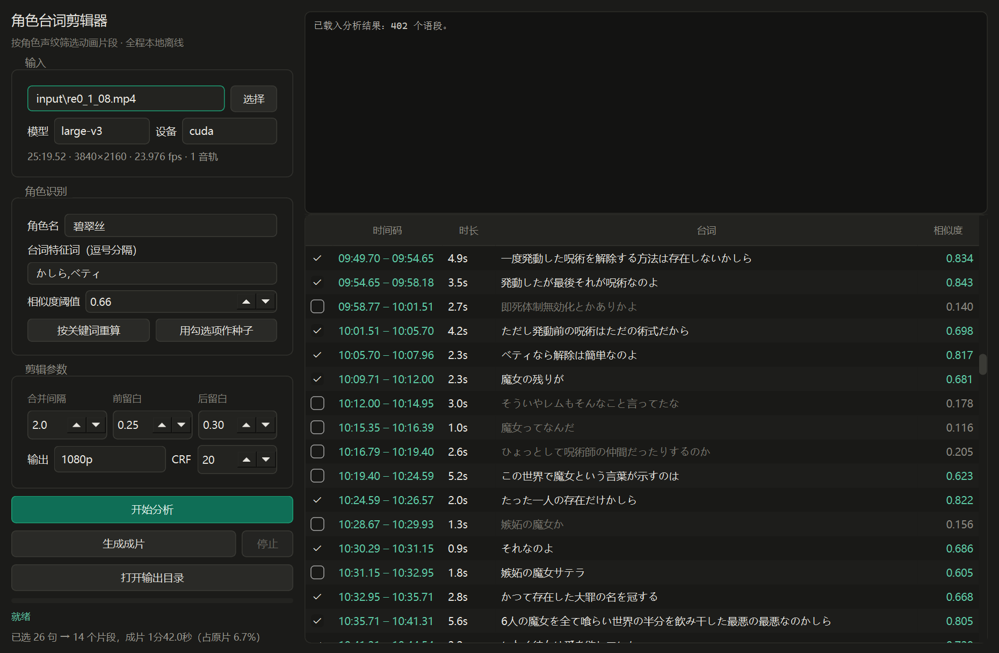

# 角色台词剪辑器

按角色声纹自动筛选动画片段，全程本地离线运行。

输入一集动画，输出只包含指定角色台词的剪辑片段。不需要字幕文件，不需要联网，不上传任何素材。



## 工作原理

核心难点是：视频里没有"谁在说话"的信息。所以走的是**闭集声纹检索**，而不是通用的说话人分离。

```
抽音频 → 日语转写（逐句时间轴）→ 逐句提取声纹向量
      → 用几句已确认属于目标角色的台词建立模板
      → 全片相似度打分 → 阈值筛选 + 人工核对 → 精确切割拼接
```

为什么不用 WhisperX + pyannote 那套通用方案：它们解决的是"开放集"问题，输出 `speaker_0 / speaker_1 / speaker_2` 这样的匿名标签，你还得自己听一遍才知道哪个是目标角色。而且 pyannote 训练集是会议和广播语音，动画配音的夸张演技 + BGM + 音效属于明显的域外数据，聚类数量经常不准。

本项目把问题改成"已知目标角色，判断每句是不是她"，绕开聚类这一步。

模板不是简单平均：先算种子与中心的相似度，用中位数和 MAD 剔除离群种子再求均值，混入的误识别或情绪极端的台词不会把模板拉偏。

## 准确率

在人工核对过的 32 句标注集上评估（`work/eval_threshold.py`）：

| 阈值 | 精确率 | 召回率 | F1 | 命中数 |
|---|---|---|---|---|
| 0.62 | 0.788 | 0.812 | 0.800 | 33 |
| 0.64 | 0.926 | 0.781 | 0.847 | 27 |
| **0.66** | **0.962** | **0.781** | **0.862** | 26 |
| 0.68 | 1.000 | 0.750 | 0.857 | 24 |
| 0.70 | 1.000 | 0.562 | 0.720 | 18 |

默认阈值取 **0.66**（F1 最高）。想要零误判可以提到 0.68，代价是漏掉约四分之一台词。

稳健模板与简单平均在同一阈值下的对比：0.66 时 F1 为 0.862 / 0.847，0.62 时差距更大（0.800 / 0.761）。

## 快速开始

### 图形界面

双击根目录的 `启动界面.bat`。

操作四步：

1. **选择视频** —— 默认已载入 `input/` 下的文件，也可以点「选择」换别的
2. **点「开始分析」** —— 抽音频 + 日语转写 + 声纹提取，25 分钟片源约 3 分钟
3. **核对勾选** —— 表格里青色高分通常是目标角色，灰色低分是其他角色。**阈值附近的句子最易误判，务必逐条看一眼**。发现漏勾就手动补上，或调整阈值后点「按关键词重算」
4. **点「生成成片」** —— 按当前勾选切割拼接，输出到 `output/`

界面左下角实时显示「已选 N 句 → M 个片段，成片 X 分 Y 秒」。

### 命令行

```bash
cd work
../.venv/Scripts/python.exe extract_audio.py              # 抽 16k 音频
../.venv/Scripts/python.exe transcribe.py                 # 日语转写
../.venv/Scripts/python.exe voiceprint.py                 # 声纹提取
../.venv/Scripts/python.exe select.py --role 碧翠丝        # 生成切点
../.venv/Scripts/python.exe cut.py                        # 切割拼接
../.venv/Scripts/python.exe gen_report.py                 # 生成清单
```

全部脚本支持 `--video` 指定源文件，省略时取 `input/` 下第一个视频。完整参数见 [`work/脚本使用说明.md`](work/脚本使用说明.md)。

## 任务隔离

每个源视频对应 `work/jobs/<源文件ID>/` 一个独立目录，ID 由文件名、大小和修改时间生成：

```
work/jobs/re0_1_08-5d77c1c0/
├── manifest.json     源文件路径、大小、修改时间、时长、宽高、帧率、模型、语言
├── audio16k.wav
├── transcript.json
├── embeddings.npz
└── selected.json     切点方案，含角色名、阈值、每段相似度
```

加载缓存前会校验 manifest：文件大小或时长对不上就不使用，切换视频时立即清空旧状态并禁用导出。所有产物先写临时文件再原子替换，失败的任务不会留下半新半旧的数据。

## 环境

| 项目 | 说明 |
|---|---|
| 系统 | Windows 10 / 11 |
| Python | 3.12（`.venv/` 已随项目自带） |
| 模型 | faster-whisper large-v3 + ECAPA-TDNN（`models/` 已自带） |
| ffmpeg | 8.1.2（`tools/ffmpeg/` 已自带） |
| GPU | 可选。有 CUDA 则转写提速 3–5 倍，无则自动降级 CPU |

依赖清单见 `requirements.txt`。项目设计为**整体自包含**：所有路径由 `work/core/paths.py` 统一推导，整个目录可以复制到任何位置直接运行。

## 目录结构

```
├── 启动界面.bat          图形界面入口
├── requirements.txt      依赖与版本
├── gui/
│   ├── main.py           主窗口
│   ├── runner.py         子进程调度（含进程树终止）
│   ├── theme.py          深色样式表
│   └── preview.png       界面截图
├── work/
│   ├── core/             核心层，GUI 与 CLI 共用
│   │   ├── paths.py      统一路径
│   │   ├── media.py      ffprobe 探测
│   │   ├── manifest.py   任务清单与缓存校验
│   │   ├── segmenter.py  片段合并
│   │   ├── scoring.py    声纹打分
│   │   └── cli.py        命令行公共部分
│   ├── extract_audio.py  抽 16k 单声道
│   ├── transcribe.py     日语转写
│   ├── voiceprint.py     声纹提取（--cluster 可选诊断）
│   ├── select.py         生成切点方案
│   ├── cut.py            切割拼接
│   ├── gen_report.py     生成核对清单
│   ├── eval_threshold.py 阈值与模板评估
│   ├── verify.py         环境自检
│   └── 脚本使用说明.md
├── tests/                单元测试（23 项）
├── input/                源视频
├── output/               成片与清单
├── models/               模型权重（3.1 GB）
├── tools/ffmpeg/         ffmpeg 副本（304 MB）
└── .venv/                Python 虚拟环境（1.2 GB）
```

## 测试

```bash
.venv/Scripts/python.exe -m unittest discover -s tests -t . -v   # 23 项单元测试
cd work && ../.venv/Scripts/python.exe verify.py                 # 环境自检
```

单元测试覆盖：片段合并的相邻/间隔/插话/缺失 ID/重复 ID/越界/负时长，声纹模板的空种子/单种子/离群剔除/负样本，以及 manifest 的匹配与失效判断。

`verify.py` 逐项检查目录、ffmpeg、模型文件、源视频探测、whisper 与 ECAPA 加载、切点合法性，任何一项失败都会返回非零退出码。

## 性能实测

25 分钟 4K HEVC 片源，RTX 4060 Laptop：

| 阶段 | 耗时 |
|---|---|
| 抽音频 | 10 秒 |
| 日语转写（403 段） | 2 分 30 秒 |
| 声纹提取（399 段） | 15 秒 |
| 相似度重算（GUI 内） | 毫秒级 |
| 切割拼接（14 段，4K 输出） | 67 秒 |

## 可调参数

| 参数 | 默认 | 作用 |
|---|---|---|
| 角色名 | — | 写入报告标题和输出文件名 |
| 台词特征词 | `かしら,ベティ` | 自动挑选种子台词。词越独特越好，`のよ` 这类通用语尾会引入误判 |
| 相似度阈值 | 0.66 | 越高越严格，标注集评估的最优 F1 点 |
| 合并间隔 | 2.0 秒 | 相邻台词间隔小于此值合并为一段 |
| 前 / 后留白 | 0.25 / 0.30 秒 | 每段前后的呼吸空间，会自动避让其他角色的语段 |
| 输出 | 保持源规格 | 也可选 1080p / 720p，缩放时保持比例、黑边补齐 |
| CRF | 20 | 数值越小画质越好、文件越大 |

## 导出规格

默认「保持源规格」：不缩放、不强制帧率，输出宽高、帧率、像素比与源一致（实测 3840×2160 / 23.976 fps / SAR 1:1 完全保持）。只有显式选择 1080p 或 720p 才缩放，且用 `force_original_aspect_ratio=decrease` 加补边，不会拉伸。

## 已知限制

- **仅支持日语**。转写阶段固定 `language="ja"`。
- **短句和强 BGM 段的声纹分不稳定**。这类句子会落在阈值下方，需要手动补勾。
- **同一声优配多个角色时无法区分**。声纹只能识别"这是谁的声音"，不能识别"这是在演哪个角色"。
- **模型只显示本地已安装的**。当前只有 large-v3，换模型需要先手动放置权重。
- **尚无内嵌试听**。核对时仍需在外部播放器按时间码定位，这是下一阶段的主要改进点。

## 免责声明

仅供个人学习与技术研究。请勿传播、分发或商用受版权保护的音视频内容。

## 致谢

[faster-whisper](https://github.com/SYSTRAN/faster-whisper) / CTranslate2 · [SpeechBrain](https://speechbrain.github.io/) ECAPA-TDNN · [FFmpeg](https://ffmpeg.org/) · [PySide6](https://doc.qt.io/qtforpython/)
